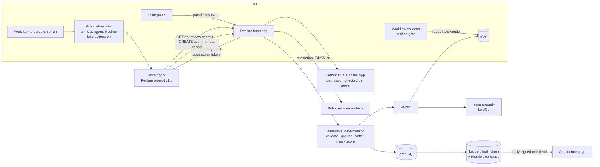

# Redline architecture

Redline turns a Jira work item into a cited STRIDE threat model, turns the threats that matter into security requirements,
and then enforces them: the work item cannot move to Done, and its pull request cannot merge, until each requirement is
verified with evidence or accepted as a risk by someone allowed to accept it. Every decision lands in a hash-chained,
Merkle-logged risk ledger.

Two Forge apps, because one app cannot carry both site and workspace scopes:

- **Redline for Jira** (`apps/core`), with Confluence as a compatible product: the review, the issue panel, the
  workflow gate, the Rovo agent and MCP tools, the admin and posture pages, and the ledger.
- **Redline for Bitbucket** (`apps/bitbucket`): a merge check that accepts a pull request touching security-sensitive
  files only with a valid, signed attestation for its head commit.

Neither manifest declares egress, so nothing leaves Atlassian's platform.

## How a review runs



1. **Trigger.** An Automation rule runs "Use agent: Redline" three times with *Let this agent take actions* on. Each run
   is one independent threat-model sample. A person can also start a review from the panel or ask the agent directly.
2. **Context (`get-review-context`).** Redline gathers the work item, its parent, children, links, comments, linked
   Confluence pages and related incidents over REST. Only the work item's key, type, status, project, components and
   fix versions are *trusted*; every piece of free text is *untrusted* and wrapped as data. Pages and incidents the
   actor cannot read are left out (they still count towards the context hash). Secrets are redacted and text that
   looks like instructions to an AI is flagged (`injectionSuspected`). The response carries a single-use submission
   token bound to this review and context hash.
3. **Proposal (the agent).** The Rovo agent writes a `redline.threatmodel.v1` JSON document: STRIDE threats, each with
   verbatim quotes from the sources as evidence.
4. **Submission (`submit-threat-model`).** The token is checked and spent. Nothing the model wrote decides anything by
   itself; `assembleReview` does, deterministically:
   - schema validation (invalid samples are discarded with a reason, never repaired silently);
   - **quote grounding**: every quote must appear in a source; unsupported threats are discarded;
   - **self-consistency**: threats are clustered across the samples and only those a majority of runs raised are kept
     (the rest are discarded as `low_votes`); a kept threat is `accepted` when its quotes are found verbatim, and
     `needs_human` (a security champion must confirm it) when its evidence is weak or it touches a source suspected of
     injection;
   - deterministic **baseline rules** add threats the domain always implies (auth, PII, payments, credentials);
   - **mapping** to OWASP ASVS 5, CWE, OWASP LLM Top 10 and the Agentic Top 10;
   - **scoring** and the **verdict** (below);
   - **carry-over (R7)**: on a re-review, threats that cite only unchanged sources keep their triage.
5. **Enforcement.** The verdict is written to KVS (read by the workflow validator, under 500 ms) and to an issue
   property (for JQL). The Bitbucket merge check verifies an attestation offline with the published public keys.

**Redline Engine** (the default for new sites, `apps/core/src/services/engine.ts`) runs the review on Forge LLMs
instead of the Rovo agent: a quarantined injection check, three runs of the Redline agent prompt over the fenced context
in parallel, deterministic assembly, then a verifier. Its calls are billed to the app's developer. See
[ENGINE.md](ENGINE.md). The earlier dual-LLM design (proposals that saw only an extracted sketch) is kept in
`packages/core/src/pipeline.ts` for the eval; it measured worse and does not run in the product.

## Risk score

```
score = min(100, round((min(70, Σ severity weights) + min(20, Σ data-class weights)) × exposure multiplier))
```

| Severity | Weight | | Data class | Weight | | Exposure | Multiplier |
| --- | --- | --- | --- | --- | --- | --- | --- |
| Low | 2 | | PII | 6 | | internal | 1.0 |
| Medium | 5 | | credentials | 8 | | partner | 1.15 |
| High | 12 | | payment | 10 | | public | 1.3 |
| Critical | 25 | | health / secrets | 8 | | | |

Only threats that are accepted, proposed or waiting for a champion count. `whatIfScore` (R12) re-scores with another
exposure or data-class set and stores nothing.

## Verdict (fails closed)

`computeVerdict` (`packages/core/src/verdict.ts`) returns `pass`, `warn` or `block` with reasons a person can act on:

| Reason | Blocks until |
| --- | --- |
| No review, or the review failed | A review completes. The AI timing out counts as missing. |
| Review out of date (context changed, or it could not be checked) | Re-run (one click from the message). |
| Paused at the budget (token budget or the site out of Rovo credits) | A security champion confirms the work item; ledgered, admin alerted. |
| Threats at or above the policy level waiting for a champion | A champion confirms them (called out separately when injection was suspected). |
| Open requirements at or above the policy level | Each is verified with evidence, marked not applicable by a champion, or covered by an active risk acceptance. |

Work that touches no sensitive path merges freely. **Warn-only** mode (per project, at most 14 days) and
**break-glass** (an admin, with a written reason) let work through, and every use is ledgered. Verdicts are recomputed
when the policy changes or a lenient verdict's window ends.

## Packages and ports

| Package | Role |
| --- | --- |
| `packages/shared` | Zod schemas and types shared by everything (threats, requirements, attestations, the agent JSON contract). |
| `packages/core` | The domain: context normalisation and redaction, assembly, grounding, consensus, scoring, verdicts, acceptance rules, ledger, transparency log, posture. Pure, behind ports. |
| `packages/crypto` | Ed25519 attestations, SHA-256 hash chain, RFC 9162 Merkle trees, on `@noble/ed25519` and `@noble/hashes`; open-source candidate. |
| `packages/db` | Forge SQL migrations and SQL implementations of the repos. |
| `packages/frameworks` | ASVS 5, CWE, OWASP LLM and Agentic Top 10 catalogues and STRIDE defaults. |
| `packages/prompts` | The agent prompt and `PROMPT_VERSION`, shared by the deployed agent and the evals. |
| `packages/llm-dev` | Dev-only `claude -p` adapter for evals; never bundled into an app. |
| `apps/core` | Forge functions, resolvers, Rovo actions, jobs, adapters (Jira, Confluence, KVS, SQL, queue) and the Custom UI (`apps/core/ui`). |
| `apps/bitbucket` | Merge check, repository settings page, settings store. |
| `apps/local` | `pnpm redline` CLI: offline review, evals, demo signing. |
| `evals` | 40 clean and 15 poisoned cases, the runner, metrics and recorded model outputs. |

Core logic depends only on ports (`packages/core/src/ports.ts`): `ClockPort`, `LlmPort`, `ContextGatherer`,
`ReviewRepo`, `RequirementRepo`, `LedgerRepo`, `FeedbackRepo`, `IssueRepo`, `AttestationRepo`, `TreeHeadRepo`,
`UsageRepo`, `VerdictSink`, `SigningKeyStore`. Every port has an in-memory fake that runs the same contract tests as the
SQL implementation (`packages/core/test/contracts`).

## Storage

| Store | What |
| --- | --- |
| Forge SQL | `reviews`, `review_stages` (doubles as the run trace), `agent_samples`, `context_facts`, `threats`, `review_discarded`, `requirements`, `feedback`, `issues`, `issue_pages`, `attestations`, `ledger`, `merkle_heads`, `posture_snapshots`, `usage_monthly`. Reviews are purged after 400 days; the ledger never is. |
| KVS | Verdicts (what the gate reads), site and project policy and its version, rate-limit counters, single-use submission tokens. |
| Forge secret storage | The Ed25519 signing key (generated on install, never sent to the UI; rotation keeps old keys verifying for a grace period). |
| Issue property `redline.verdict` | Searchable copy of the verdict for JQL and dashboards. It is never read by the gate, because users can edit issue properties. |

## The ledger

Every acceptance, approval, revocation, confirmation, break-glass, warn-only switch and policy change is appended to
`ledger` with `entryHash = SHA-256(prevHash ‖ canonical entry)`; there is no update or delete path. Once a day Redline
builds an RFC 9162 Merkle tree over the entry hashes, signs the tree head with the attestation key, stores it and posts
it to a Confluence page. An admin can download a proof for any entry (inclusion in the signed tree, plus consistency
with the last published head) and anyone can check it offline with `node scripts/verify-ledger-proof.mjs proof.json`,
which uses only Node built-ins.

## Surfaces

- **Issue panel**: verdict and the reasons behind it, risk score, threats (plain language first, evidence quotes with
  links), requirements and evidence, risk acceptances, history and the diff since the last review, what-if, merge
  attestation, champion triage.
- **Admin page**: first-run wizard, projects and guarded transitions, severity policy, roles, budgets, warn-only,
  notifications, recent runs with stage timings, signing keys, ledger verification and Merkle proofs, demo data.
- **Security posture** global page and dashboard gadget: open Critical/High, where they are, trend, release report.
- **Rovo agent** "Redline" and **MCP server** (`rovo:mcp`): get a review, requirements, change risk, attestation,
  request acceptance, explain a threat, release readiness, posture.
- **Confluence**: the threat model published as a page; the weekly digest; the ledger tree heads.
